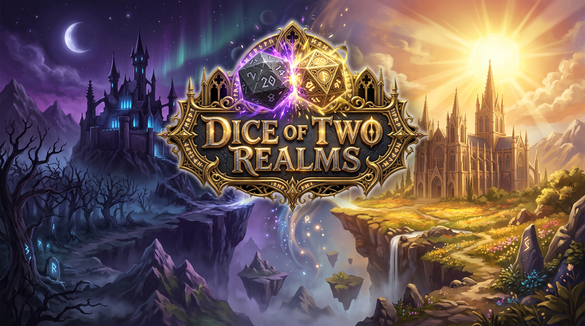

# 🎲 Dice of Two Realms

> **Dice of Two Realms** — это атмосферная карточная мини-игра, где бросок кубиков решает судьбу. Две великие силы — Лунный ковен и Солнечный орден — встречаются на поле битвы.

**Автор:** [LE2AN](https://github.com/LE2AN)

---

## ✨ Особенности игры
*   🎲 **3D-кубики:** Каменные грани с золотыми точками и реалистичной анимацией.
*   🃏 **12 персонажей:** Уникальные арты девушек из двух фракций.
*   🗣️ **Интерактивный ассистент:** Милая Элика приветствует вас и комментирует каждый бросок с разными эмоциями.
*   ⚔️ **Механика комбо:** Совпадение тегов вызывает эпичные эффекты.
*   🖥️ **Главное меню:** Полноценная заставка с логотипом и экраном «Об игре».

---

## 🎮 Как играть
1. Скачайте актуальный `.exe` файл в разделе **[Releases](https://github.com/LE2AN/Kubik/releases)**.
2. Запустите игру и нажмите **«Играть»**.
3. Бросайте кубики и собирайте комбо!

---

## 🛠 Технологический стек
Проект написан с любовью к чистому коду, без использования тяжелых фреймворков:
*   **HTML5** (структура)
*   **CSS3** (3D-трансформации, анимации, Grid/Flexbox)
*   **JavaScript** (Vanilla JS, игровая логика)
*   **Инструменты:** VS Code + Live Server, Git, GitHub, HTML2EXE (для сборки в .exe).

---

## 📜 История версий
- **v1.2.1** — 🗣️ Добавлен ассистент Элика, модульная архитектура JS, экран «Об игре», loading screen, кнопка выхода, звуки кликов, случайные фразы.
- **v1.10** — 🖥️ Главное меню, заставка, кнопки управления звуком.
- **v1.09** — 🪨 Новый каменный стол, идеальные пропорции карточек.
- **v1.08** — 🔊 Звуковое сопровождение (музыка, SFX).
- **v1.07** — 🎲 Каменные 3D-кубики с золотыми точками.
- **v1.06** — Глобальный визуальный редизайн, арты девушек.
- **v1.05** — Карточки вынесены по бокам, анимация плюса и суммы.
- **v1.04** — Футер автора, исчезновение карточек.
- **v1.03** — Арт-фон, полупрозрачная панель.
- **v1.02** — Теги и комбо-баннер.
- **v1.01** — Разделение на 3 файла.
- **v1.0** — Первая рабочая версия.

---

*Сделано с душой и нейросетями.* 🎲✨
