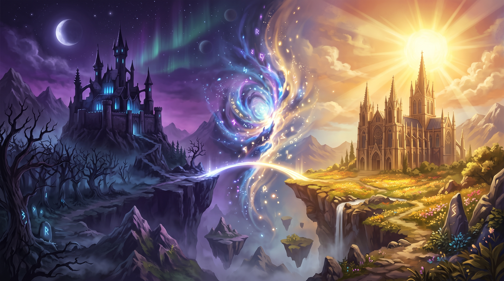

# 🎲 Dice of Two Realms

> **Dice of Two Realms** — это атмосферная карточная мини-игра, где бросок кубиков решает судьбу. Две великие силы — Лунный ковен и Солнечный орден — встречаются на поле битвы.

**Автор:** [LE2AN](https://github.com/LE2AN)

---

## ✨ Особенности игры

*   🎲 **Уникальные 3D-кубики:** Каменные грани с золотыми светящимися точками и реалистичной 3D-анимацией броска.
*   🃏 **12 фэнтези-персонажей:** Шикарные авторские арты девушек из двух противоборствующих фракций.
*   ⚔️ **Классы и теги:** У каждой героини есть свой класс (Воин, Маг, Жрица, Природа).
*   ✨ **Механика комбо:** Если на обоих кубиках выпадают девушки с одинаковым тегом — срабатывает эпичный визуальный эффект.
*   🌈 **Цветовая индикация:** Кубики подсвечиваются в зависимости от суммы броска (зеленый крит, красный провал, нейтральный).
*   💎 **Стильный UI:** Полупрозрачные панели, размытие фона, плавные анимации появления элементов и виньетка.
*   🔊 **Звук и музыка:** Добавлено звуковое сопровождение.

---

## 🎮 Как играть

Игра не требует установки (Portable версия). 
1. Скачай актуальный `.exe` файл в разделе **[Releases](https://github.com/LE2AN/Kubik/releases)**.
2. Запусти файл и нажми **«Кинуть кубики»**.

**Правила:**
*   **Левый кубик** призывает темных героинь из **Лунного ковена**.
*   **Правый кубик** призывает светлых воительниц из **Солнечного ордена**.
*   Следи за совпадением тегов — это активирует **Комбо**!

---

## 🚀 В планах на будущее
- [ ] Заставка (Главное меню) с логотипом игры.
- [ ] Расширение колоды персонажей.
- [ ] Переход к полноценной карточной mechanics (Дуэль фракций).
- [ ] Адаптация под мобильные устройства (Android).

---

## 🛠 Технологический стек
Проект написан с любовью к чистому коду, без использования тяжелых фреймворков:
*   **HTML5** (структура)
*   **CSS3** (3D-трансформации, анимации, Grid/Flexbox)
*   **JavaScript** (Vanilla JS, игровая логика)
*   **Инструменты:** VS Code + Live Server, Git, GitHub, HTML2EXE (для сборки в .exe).

---

## 📜 История версий

- **v1.08** — 🎵 Добавлено звуковое сопровождение: музыка, звуки кубиков и эффектов.
- **v1.07** — 🪨 *(Текущая)* Полностью новые 3D-кубики с каменной текстурой и золотыми точками. Исправлена четкость (рендеринг) карточек персонажей.
- **v1.06** — Глобальный визуальный редизайн. Добавлены арты всех 12 девушек, стабильная сетка интерфейса.
- **v1.05** — Редизайн: карточки вынесены по бокам, добавлена анимация плюса и суммы.
- **v1.04** — Футер автора, карточки девушек теперь исчезают при новом броске.
- **v1.03** — Арт-фон с двумя замками, полупрозрачная панель, стилизованные карточки.
- **v1.02** — Добавлены теги девушек и комбо-баннер.
- **v1.01** — Рефакторинг: разделение на 3 файла, цветная подсветка кубиков.
- **v1.0** — Первая рабочая версия (Симулятор броска).

---
*Сделано с душой и нейросетями.* 🎲✨
